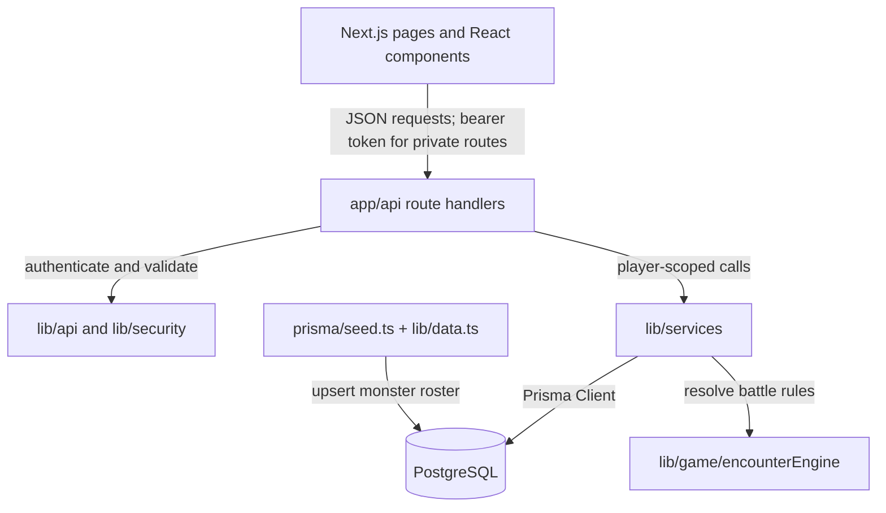
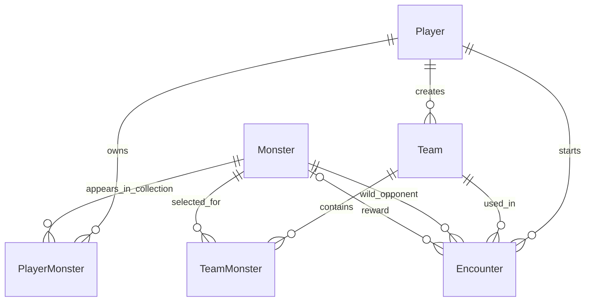

# Project Architecture, Game Data, and Security

This guide describes how Monster Tamers is currently implemented. It is based on
the Prisma schema, API route handlers, services, authentication helpers, and game
engine in this repository. The application is a teaching prototype, not a
production security certification.

For a gameplay-focused table reference and DBeaver queries, see
[`GAME_DATA.md`](./GAME_DATA.md).

## Contents

- [Architecture at a glance](#architecture-at-a-glance)
- [Database tables and game data](#database-tables-and-game-data)
- [Relationships](#relationships)
- [Gameplay and persistence flow](#gameplay-and-persistence-flow)
- [Authentication and authorization](#authentication-and-authorization)
- [Security controls and limitations](#security-controls-and-limitations)
- [Project layout](#project-layout)
- [Database setup and inspection](#database-setup-and-inspection)

## Architecture at a glance

The project is a single Next.js application with server-side REST route handlers,
Prisma as its data-access layer, and PostgreSQL as the persistent store. The
browser UI calls the same-origin API; it does not decide battle outcomes.



The request path is intentionally layered:

1. A page or component issues an API request through the client helpers in
   `lib/api/client.ts`.
2. A route handler parses and validates input, authenticates private requests,
   and maps expected service/domain errors to HTTP responses.
3. A service in `lib/services` applies ownership and game-rule checks, then reads
   or writes through the shared Prisma client in `lib/db/prisma.ts`.
4. `lib/game/encounterEngine.ts` calculates the encounter result from server-side
   monster stats. The service persists the result and any reward.
5. The route returns JSON; the UI animates and displays the already-resolved
   result.

The monster catalogue is seeded data. Player collections, teams, and encounters
are stored in PostgreSQL and remain available after the server restarts.

## Database tables and game data

The canonical definitions are in [`prisma/schema.prisma`](../prisma/schema.prisma).
Prisma's model names below correspond to PostgreSQL tables; the exact physical
table-name casing follows Prisma's defaults.

### `Player`

One account / trainer.

| Column | Type | Purpose |
| --- | --- | --- |
| `id` | `String` (primary key, CUID) | Internal player identifier and foreign-key target |
| `username` | `String` | Display name |
| `usernameNormalized` | `String`, unique | Lowercase lookup key used to enforce case-insensitive username uniqueness |
| `passwordHash` | `String` | Salted scrypt password hash; the original password is not stored |
| `createdAt` | `DateTime` | Account creation time, defaulting to the database time |

Relations: one player has many collection entries (`PlayerMonster`), teams
(`Team`), and encounters (`Encounter`).

### `Monster`

The shared game catalogue of playable and wild monsters.

| Column | Type | Purpose |
| --- | --- | --- |
| `id` | `String` (primary key) | Stable roster identifier; seeded entries currently use IDs such as `m1` |
| `name` | `String` | Monster name |
| `description` | `String` | Catalogue description |
| `imageUrl` | `String` | Image location used by the UI |
| `emoji` | `String` | Compact visual representation |
| `attack` | `Int` | Attack stat used by encounter power calculation |
| `defense` | `Int` | Defense stat used by encounter power calculation |
| `speed` | `Int` | Speed stat used by encounter power calculation |
| `element` | `String` | Element/category metadata |
| `rarity` | `String` | Rarity metadata |
| `createdAt` | `DateTime` | Catalogue record creation time |

Relations connect a monster to owners, team memberships, encounters where it
appeared as the wild monster, and encounters where it was awarded as a reward.
Roster contents are defined in `lib/data.ts` and upserted by `prisma/seed.ts`.

### `PlayerMonster`

Join table representing monsters owned by a player. Each row means that the
player owns one catalogue monster; this is not a separate copy of its stats.

| Column | Type | Purpose |
| --- | --- | --- |
| `id` | `String` (primary key, CUID) | Collection-entry identifier |
| `playerId` | `String` (foreign key to `Player.id`) | Owner |
| `monsterId` | `String` (foreign key to `Monster.id`) | Owned catalogue monster |
| `obtainedAt` | `DateTime` | Time added to the collection |

Constraints and indexes:

- `@@unique([playerId, monsterId])` prevents duplicate ownership of the same
  monster by the same player.
- `@@index([playerId])` supports player collection queries.

### `Team`

A named team belonging to a player.

| Column | Type | Purpose |
| --- | --- | --- |
| `id` | `String` (primary key, CUID) | Team identifier |
| `name` | `String` | Team name |
| `playerId` | `String` (foreign key to `Player.id`) | Team owner |
| `createdAt` | `DateTime` | Creation time |

Relations: a team belongs to one player and has many `TeamMonster` links. Its
encounters are recorded against that team. `@@index([playerId])` supports listing
teams by owner.

### `TeamMonster`

Join table connecting a team to its selected catalogue monsters. Team creation
validates that each selected monster is already in that player's collection and
that the team contains between one and three distinct monsters.

| Column | Type | Purpose |
| --- | --- | --- |
| `id` | `String` (primary key, CUID) | Team-membership identifier |
| `teamId` | `String` (foreign key to `Team.id`) | Team |
| `monsterId` | `String` (foreign key to `Monster.id`) | Team member |

Constraints and indexes:

- `@@unique([teamId, monsterId])` prevents the same monster appearing twice on
  one team.
- `@@index([teamId])` supports team membership reads.
- Deleting a team cascades to its team links (`onDelete: Cascade`).

### `Encounter`

An immutable-style history record for a resolved battle. Both wins and losses
are recorded. Reward ownership is represented separately by a `PlayerMonster`
row.

| Column | Type | Purpose |
| --- | --- | --- |
| `id` | `String` (primary key, CUID) | Encounter identifier |
| `playerId` | `String` (foreign key to `Player.id`) | Player who initiated the encounter |
| `teamId` | `String` (foreign key to `Team.id`) | Team used |
| `wildMonsterId` | `String` (foreign key to `Monster.id`) | Monster fought |
| `outcome` | `String` | Stored outcome (`win` or `loss`) |
| `playerPower` | `Float` | Player team power at resolution time |
| `wildPower` | `Float` | Wild monster power at resolution time |
| `summary` | `String` | Human-readable server-generated result |
| `rewardMonsterId` | `String?` (optional foreign key to `Monster.id`) | Awarded catalogue monster on a win, if available |
| `createdAt` | `DateTime` | Resolution time |

`@@index([playerId, createdAt])` supports a player's reverse-chronological
history. The player and team IDs are both stored, and service queries ensure
that the team belongs to the authenticated player before resolving a battle.

### Table inventory by gameplay purpose

| Gameplay concept | Table(s) |
| --- | --- |
| Account and login identity | `Player` |
| Shared monster roster and stats | `Monster` |
| Player's monster collection | `PlayerMonster` joined to `Monster` |
| Team membership | `Team` and `TeamMonster` joined to `Monster` |
| Resolved battle and history | `Encounter`, joined to its player, team, wild monster, and optional reward monster |
| Monster reward ownership | `PlayerMonster` plus `Encounter.rewardMonsterId` |

## Relationships



`PlayerMonster` and `TeamMonster` are explicit many-to-many join tables. The
schema uses foreign keys so collection, team, and encounter records point back
to known players, teams, and catalogue monsters.

## Gameplay and persistence flow

### Registration

`POST /api/auth/register` validates the username and password, applies the
registration rate limit, hashes the password, and creates the account together
with starter ownership and a starter team. The starter collection uses `m1`,
`m2`, and `m3`; the `Starter Squad` starts with `m1` and `m2`. The roster must
have been seeded first. The API response omits `passwordHash`.

### Team creation

`POST /api/teams` accepts a team name and monster IDs. The team service trims the
name, rejects repeated monster IDs, enforces the one-to-three member limit, and
checks that every selected monster is owned by the authenticated player before
creating `Team` and its `TeamMonster` rows.

### Encounter resolution

`POST /api/encounters` accepts a team ID and wild monster ID. The service runs
the following operations inside a PostgreSQL serializable transaction:

1. Find the requested team scoped to the authenticated player and load its
   catalogue monster stats.
2. Reject an unknown team, an empty team, or an unknown wild monster.
3. Build a reward pool from catalogue monsters the player does not already own.
4. Call `resolveEncounter` in `lib/game/encounterEngine.ts`.
5. If there is a reward, add it to `PlayerMonster`.
6. Persist an `Encounter` row with the outcome, rounded power values, summary,
   team, opponent, and optional reward.

The transaction keeps reward ownership and encounter history consistent: a
failed write does not leave a successfully reported partial battle. The backend
is authoritative; UI animation presents the saved server result rather than
simulating or choosing the winner.

### Battle power and reward rule

`calculatePower` averages each stat across the player's team, then weights the
averages:

```text
power = averageAttack * 1.7 + averageDefense * 1.1 + averageSpeed * 1.4
```

The wild monster is evaluated as a one-monster team. A tie counts as a player
win (`playerPower >= wildPower`). When the player wins and the reward pool is
not empty, the engine selects an eligible reward monster; if the player loses,
or no unowned monsters remain, no reward monster is added. The stored
`playerPower` and `wildPower` are rounded to one decimal place; the comparison
uses the calculated values before storage rounding.

### History and ownership scope

`GET /api/encounters` and `GET /api/history` return the authenticated player's
history ordered newest first. `GET /api/encounters/{id}` scopes lookup by both
encounter ID and player ID. Collection and team endpoints likewise derive the
player ID from the verified token; supplying another player's ID does not grant
access.

For endpoint request/response details, see [`API.md`](./API.md).

## Authentication and authorization

### Registration and password storage

- Passwords are hashed with Node.js `scrypt` and a cryptographically random
  16-byte salt. The stored string includes the algorithm, salt, and derived key;
  raw passwords are not stored.
- Password verification derives a candidate key and compares it with
  `timingSafeEqual`.
- Usernames are normalized to lowercase for lookup. A unique constraint on
  `usernameNormalized` prevents case variants from creating separate accounts.
- Login errors use a generic invalid-credentials response, rather than
  disclosing whether the username exists.

### Access tokens

- Successful registration and login return a signed JWT access token.
- Tokens use HS256 and include a subject set to the player's ID, the configured
  issuer and audience, and a one-hour expiration.
- `JWT_SECRET` must be configured and contain at least 32 characters. The
  application fails rather than using an insecure fallback when it is missing
  or too short.
- Private API requests present the token as an HTTP bearer token in the
  `Authorization` header. `authenticateRequest` verifies the signature,
  algorithm, issuer, audience, and expiration, then uses the verified subject as
  the player identity.
- A request body or URL player ID is not treated as proof of identity. Services
  use the authenticated player ID for collection, team, and encounter scoping.

### Browser token handling

The UI stores the bearer token in tab-scoped `sessionStorage`. This avoids
persisting the token across browser restarts, but it remains accessible to
same-origin JavaScript. Logging out removes the browser's copy; it does not
revoke a token already copied elsewhere. Tokens remain usable until their
one-hour expiry unless the signing secret is rotated.

## Security controls and limitations

### Implemented controls

- Server-side bearer-token verification on private routes.
- Database ownership scoping based on the verified token subject.
- Zod validation for request bodies and credentials.
- Scrypt password hashing with per-password salt and timing-safe comparison.
- Generic login failure responses.
- Per-process rate limits: 10 login attempts per IP per 15 minutes and 20
  registrations per IP per hour.
- Basic response headers against MIME sniffing, framing, referrer leakage, and
  access to selected browser capabilities.
- Transactional encounter, reward, and history writes.
- Database uniqueness constraints for normalized usernames, ownership
  membership, and team membership.

### Known limitations and deployment requirements

- **Content Security Policy:** no CSP is currently configured. Add and test a
  restrictive CSP and prevent cross-site scripting before using real accounts.
- **Rate-limit storage:** limits are held in process memory, reset on restart,
  and are not shared across application instances. Use shared storage for
  multi-instance deployments. Configure the trusted reverse proxy to overwrite
  `X-Forwarded-For`; do not trust client-supplied forwarding headers directly.
- **Session/token lifecycle:** password reset, email verification, account
  deletion, and token revocation are not implemented. Logout cannot revoke a
  previously copied token.
- **Transport and secrets:** use HTTPS in deployment and load `JWT_SECRET` from
  a secret manager. Keep `.env` out of version control and rotate secrets
  deliberately.
- **Database exposure:** the local Docker Compose configuration uses a simple
  development password. Do not expose that PostgreSQL service to untrusted
  networks or reuse those credentials in production.
- **Dependency advisories:** the current dependency audit reports outstanding
  advisories. See [`SECURITY.md`](./SECURITY.md) for the recorded audit details
  and the reason a forced, potentially breaking dependency update was avoided.
- **Scope of review:** these controls are not a substitute for a deployment
  threat model, a full security assessment, backups, monitoring, and operational
  access controls.

For the maintained security review notes, see [`SECURITY.md`](./SECURITY.md).

## Project layout

| Path | Responsibility |
| --- | --- |
| `app/` | Next.js UI pages and shared application layout |
| `app/api/` | REST route handlers for auth, monsters, collections, teams, encounters, and history |
| `components/` | React UI, auth controls, team selection, and battle presentation |
| `lib/api/` | Request parsing, authentication integration, and browser API client |
| `lib/db/prisma.ts` | Shared Prisma client |
| `lib/data.ts` | Seed roster data and shared monster types |
| `lib/game/` | Battle calculation and encounter outcome rules |
| `lib/security/` | Password hashing, JWT handling, and authentication request limits |
| `lib/services/` | Database-backed player, team, monster, and encounter operations |
| `prisma/schema.prisma` | PostgreSQL data model, relations, indexes, and uniqueness constraints |
| `prisma/seed.ts` | Upserts the monster roster |
| `docs/` | API, architecture/security, and performance documentation |

## Database setup and inspection

For local development, the README's normal setup is:

```sh
docker compose up -d db
npm run db:push
npm run db:seed
```

The local Docker Compose database uses:

| Setting | Value |
| --- | --- |
| Host | `localhost` |
| Port | `5432` |
| Database | `monster_tamers` |
| Username | `postgres` |
| Password | `postgres` |
| Schema | `public` |

These are development-only credentials. Use stronger credentials and network
restrictions outside local development. In DBeaver, connect with the settings
above, then expand `monster_tamers` → `Schemas` → `public` → `Tables` to inspect
the game tables described in this guide.
