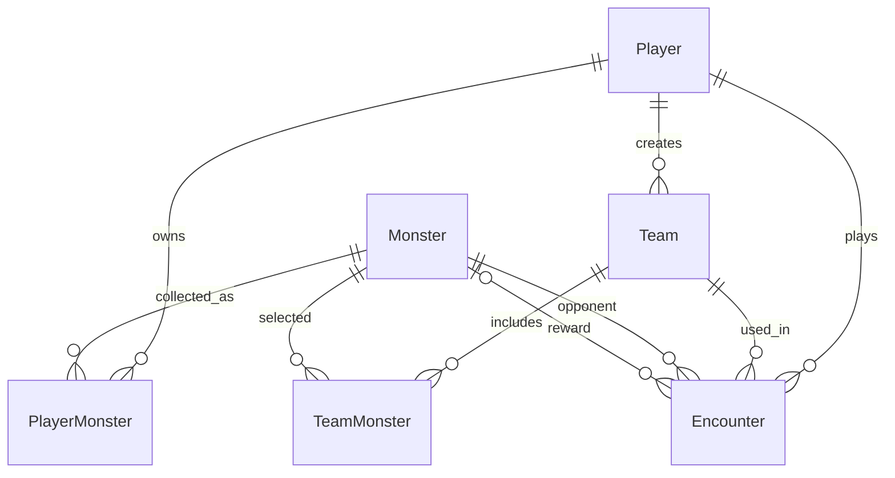

# Game Logic Database Tables

This document focuses on the PostgreSQL tables that store the Monster Tamers
roster, player collections, teams, battle results, and rewards. The Prisma
schema in [`prisma/schema.prisma`](../prisma/schema.prisma) is the source of
truth for columns and relationships. The gameplay rules described here are
implemented in `lib/services` and `lib/game/encounterEngine.ts`.

For the full application layers and authentication design, see
[`ARCHITECTURE.md`](./ARCHITECTURE.md). For API endpoints, see
[`API.md`](./API.md).

## Tables used by gameplay

The gameplay model consists of six tables:

| Table | Role in the game |
| --- | --- |
| `Player` | Identifies the trainer who owns collections, creates teams, and plays encounters |
| `Monster` | Shared roster containing monster identity, stats, and UI metadata |
| `PlayerMonster` | Records which roster monsters each player owns |
| `Team` | Stores a player's named team |
| `TeamMonster` | Lists the monsters selected for each team |
| `Encounter` | Stores the resolved battle result and any reward reference |

`PlayerMonster` and `TeamMonster` are join tables: their rows connect records
without duplicating the monster's stats.

## Table details

### `Player` — trainer and data owner

| Column | Meaning |
| --- | --- |
| `id` | Player primary key (CUID) |
| `username` | Display name |
| `usernameNormalized` | Unique lowercase username used for account lookup |
| `passwordHash` | Salted password hash; never use this field as a game statistic |
| `createdAt` | Account creation timestamp |

A player has collection rows, teams, and encounters. The API uses the
authenticated player's ID to scope access to those gameplay records.

### `Monster` — shared game roster

| Column | Meaning |
| --- | --- |
| `id` | Roster monster ID (seed entries use IDs such as `m1`) |
| `name` | Display name |
| `description` | Catalogue description |
| `imageUrl` | Image shown in the game UI |
| `emoji` | Compact visual marker |
| `attack` | Attack stat used by the battle power formula |
| `defense` | Defense stat used by the battle power formula |
| `speed` | Speed stat used by the battle power formula |
| `element` | Element/category metadata |
| `rarity` | Rarity metadata |
| `createdAt` | Roster row creation timestamp |

This is shared catalogue data, not an ownership table. The roster is authored
in `lib/data.ts` and inserted or updated by `prisma/seed.ts`.

### `PlayerMonster` — player collection

| Column | Meaning |
| --- | --- |
| `id` | Collection row primary key |
| `playerId` | Owning player; foreign key to `Player.id` |
| `monsterId` | Owned roster entry; foreign key to `Monster.id` |
| `obtainedAt` | Time the monster entered the collection |

The unique pair `(playerId, monsterId)` prevents a player from owning duplicate
copies of one roster monster. On registration, starter collection rows are
created for `m1`, `m2`, and `m3`. Winning an encounter can add another row.

### `Team` — named player team

| Column | Meaning |
| --- | --- |
| `id` | Team primary key |
| `name` | Player-provided team name |
| `playerId` | Team owner; foreign key to `Player.id` |
| `createdAt` | Team creation timestamp |

The player relation is indexed to make listing a player's teams efficient.
Registration creates a `Starter Squad`.

### `TeamMonster` — team members

| Column | Meaning |
| --- | --- |
| `id` | Team membership row primary key |
| `teamId` | Parent team; foreign key to `Team.id` |
| `monsterId` | Selected roster monster; foreign key to `Monster.id` |

The unique pair `(teamId, monsterId)` prevents duplicate entries on one team.
The service enforces one to three distinct members and verifies each selected
monster is in the team's owner's collection. The starter team contains `m1` and
`m2`. Deleting a team cascades to its membership rows.

### `Encounter` — battle history

| Column | Meaning |
| --- | --- |
| `id` | Encounter primary key |
| `playerId` | Player who initiated the battle |
| `teamId` | Team used for the battle |
| `wildMonsterId` | Roster monster selected as the opponent |
| `outcome` | Stored result: `win` or `loss` |
| `playerPower` | Player team power saved to one decimal place |
| `wildPower` | Wild monster power saved to one decimal place |
| `summary` | Server-generated battle summary |
| `rewardMonsterId` | Optional roster monster ID awarded for a win |
| `createdAt` | Battle resolution timestamp |

Encounter history is indexed by `(playerId, createdAt)` so a player's encounters
can be queried newest first. An encounter records a reference to the reward
monster, while `PlayerMonster` records actual ownership.

## Relationships



## How the tables participate in a battle

When the client requests an encounter, it sends a team ID and wild monster ID.
The server performs the following operations:

1. It finds `Team` by both the requested team ID and authenticated `playerId`.
2. It reads that team's `TeamMonster` links and joins them to `Monster` to load
   the current team member stats.
3. It reads the wild opponent from `Monster`.
4. It reads the player's `PlayerMonster` rows to identify roster entries the
   player does not yet own and can receive as a reward.
5. The game engine computes the battle outcome.
6. On a win with an available reward, it adds a `PlayerMonster` row.
7. It writes the `Encounter` row with the result, power scores, summary, and
   optional reward ID.

These reads and writes run in a serializable database transaction, so the
reward and history are saved atomically. If the transaction fails, it does not
leave a partial successful encounter.

### Battle power rule

For each side, the engine averages attack, defense, and speed across its
monsters, then calculates:

```text
power = averageAttack * 1.7 + averageDefense * 1.1 + averageSpeed * 1.4
```

The wild monster is treated as a one-monster side. A tie is a player win. The
power comparison uses the full calculated values; the scores stored in
`Encounter` are rounded to one decimal place. The battle result is decided by
the server, not by the UI animation.

### Reward rule

The service builds the reward pool from `Monster` rows whose IDs are absent
from the player's `PlayerMonster` collection. A reward is selected only if the
player wins and the reward pool is non-empty. A loss, or a win after the player
owns every roster monster, creates no reward ownership row.

## Constraints and indexes that protect gameplay data

| Schema constraint | Effect |
| --- | --- |
| Unique `Player.usernameNormalized` | Prevents duplicate usernames ignoring case |
| Unique `(PlayerMonster.playerId, PlayerMonster.monsterId)` | Prevents duplicate ownership |
| Unique `(TeamMonster.teamId, TeamMonster.monsterId)` | Prevents duplicate membership in a team |
| Index `PlayerMonster.playerId` | Speeds up collection lookups |
| Index `Team.playerId` | Speeds up team listing by owner |
| Index `TeamMonster.teamId` | Speeds up loading team members |
| Index `Encounter.playerId, Encounter.createdAt` | Speeds up a player's reverse-chronological history |
| Foreign-key relations | Require referenced player, monster, and team rows to exist |

The database uniqueness constraints complement, but do not replace, service
validation. For example, the team-size limit and ownership check are enforced
in `teamService.ts`.

## Inspecting game data in DBeaver

Connect to the local development database using the settings in the repository's
Docker Compose configuration:

| Setting | Local value |
| --- | --- |
| Host | `localhost` |
| Port | `5432` |
| Database | `monster_tamers` |
| Username | `postgres` |
| Password | `postgres` |
| Schema | `public` |

These credentials are development-only. Do not expose the database or reuse
them in production.

After connecting, expand `monster_tamers` → `Schemas` → `public` → `Tables`.
Useful read-only queries include:

```sql
-- Catalogue and battle stats
SELECT id, name, attack, defense, speed, element, rarity
FROM "Monster"
ORDER BY name;

-- Player collection with monster details
SELECT pm."playerId", m.id AS "monsterId", m.name, pm."obtainedAt"
FROM "PlayerMonster" pm
JOIN "Monster" m ON m.id = pm."monsterId"
ORDER BY pm."playerId", pm."obtainedAt";

-- Teams and their monsters
SELECT t.id AS "teamId", t.name AS "teamName", t."playerId", m.id AS "monsterId", m.name
FROM "Team" t
JOIN "TeamMonster" tm ON tm."teamId" = t.id
JOIN "Monster" m ON m.id = tm."monsterId"
ORDER BY t."createdAt", m.name;

-- Battle history with wild and reward monster names
SELECT e.id, e.outcome, e."playerPower", e."wildPower",
       wild.name AS "wildMonster", reward.name AS "rewardMonster", e."createdAt"
FROM "Encounter" e
JOIN "Monster" wild ON wild.id = e."wildMonsterId"
LEFT JOIN "Monster" reward ON reward.id = e."rewardMonsterId"
ORDER BY e."createdAt" DESC;
```
