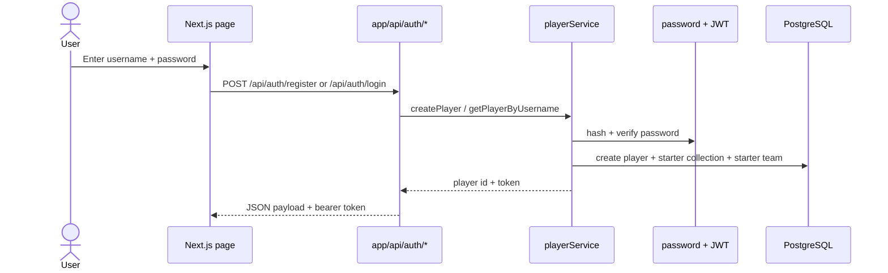
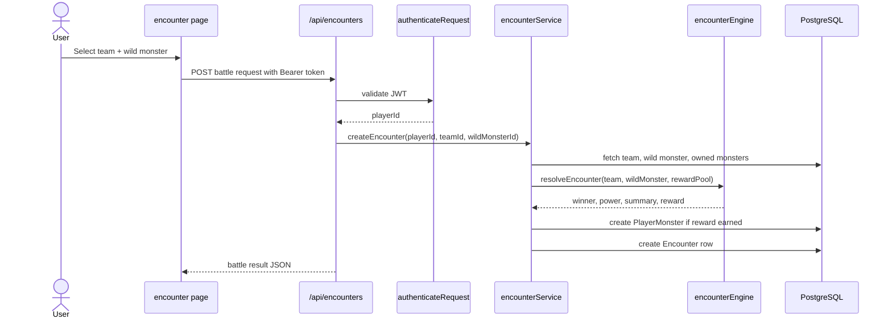
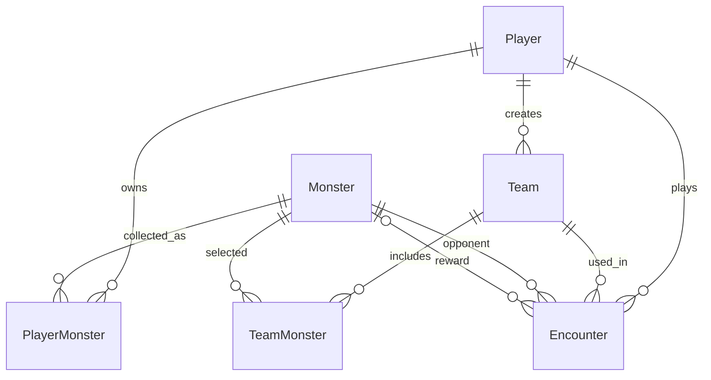

# Monster Tamers Repository Guide

This repo is a small, playable monster-collection game built with Next.js, Prisma, and PostgreSQL. The app lets a trainer create an account, manage a monster collection, build teams, fight wild monsters, and persist battle history.

## 1) Repository overview

At a high level, the codebase is split into four major layers:

- Frontend/UI: `app/` and `components/`
- API layer: `app/api/`
- Domain/game logic: `lib/services/`, `lib/game/`, and `lib/security/`
- Persistent data layer: `prisma/schema.prisma` and PostgreSQL

The application is designed around a single Next.js app with server-side REST handlers. The browser renders pages and calls the API; battle outcomes are resolved in the server layer rather than on the client.

## 2) How the project is organized

```text
monster/
├── app/                    # App Router pages and route handlers
│   ├── api/                # REST endpoints for auth, monsters, teams, history
│   ├── login/              # Login/registration page
│   ├── monsters/           # Catalog page
│   ├── team/               # Team management UI
│   ├── encounter/          # Battle UI
│   └── history/            # Encounter history UI
├── components/             # Shared UI (if used by pages)
├── lib/                   # Reusable logic and service layer
│   ├── api/                # Request parsing and auth helpers
│   ├── db/                 # Prisma client singleton
│   ├── game/               # Encounter simulation engine
│   ├── security/           # JWT and password utilities
│   └── services/           # Player, team, and encounter services
├── prisma/                 # Prisma schema and seeding logic
├── public/                 # Static assets
├── scripts/                # Performance and API smoke checks
├── docs/                   # Architecture and gameplay documentation
├── README.md               # Project summary and setup
├── package.json            # Scripts and dependencies
├── Dockerfile              # Container build
├── docker-compose.yml      # Local DB and app service config
├── .env.example            # Sample environment variables
└── .gitignore
```

## 3) Architecture

### Frontend

The UI is composed of Next.js pages under `app/`.

- `app/login/page.tsx` handles trainer login and registration
- `app/monsters/page.tsx` displays the public monster roster
- `app/team/page.tsx` lets the player create and inspect teams
- `app/encounter/page.tsx` triggers a battle against a wild monster
- `app/history/page.tsx` shows prior encounter outcomes

These pages do not directly apply game rules; they fetch and display API responses.

### API layer

The REST layer sits under `app/api/*`.

- `app/api/auth/register/route.ts` creates a player and issues a JWT
- `app/api/auth/login/route.ts` validates credentials and returns a bearer token
- `app/api/teams/route.ts` lists or creates teams for the authenticated player
- `app/api/encounters/route.ts` creates a battle and returns a result history record
- `app/api/players/[id]/collection/route.ts` exposes owned monsters
- `app/api/history/route.ts` lists a player's battle history

The route handlers validate request data with `zod`, lock down auth with JWT checks, and convert domain errors into HTTP responses.

### Service layer

The business logic lives under `lib/services/`.

- `playerService.ts`
  - creates a player
  - hashes the password
  - seeds the startup collection (`m1`, `m2`, `m3`)
  - creates the starter team (`Starter Squad`)
- `teamService.ts`
  - validates the team name
  - enforces the one-to-three monster rule
  - verifies selected monsters belong to the logged-in player
  - creates the team in the database
- `encounterService.ts`
  - loads the player's selected team and the wild monster
  - computes battle outcome
  - picks a reward monster if applicable
  - writes the `Encounter` result and persists ownership updates inside a transaction

### Game engine

The battle rules are computed in `lib/game/encounterEngine.ts`.

The power formula is:

```text
power = avgAttack * 1.7 + avgDefense * 1.1 + avgSpeed * 1.4
```

- Player team power is the average of attack/defense/speed across all monsters in the team.
- Wild monster power is calculated as a single-monster side.
- The server decides the winner. The UI only animates the result.

## 4) Data flow

### A. Registration / login flow



### B. Battle flow



The important part is that the service runs in a Prisma transaction and writes both reward ownership and encounter history atomically.

## 5) Core business logic

### Player creation

When a user registers:

- password is salted and hashed via `lib/security/password.ts`
- lowercase username is stored in `usernameNormalized` for uniqueness checks
- starter monsters are assigned to the player's collection
- a default `Starter Squad` team is created with `m1` and `m2`

### Team creation

A team is valid only when:

- a non-empty name is supplied
- there are between 1 and 3 unique monster IDs
- each monster belongs to the authenticated trainer

This validation happens in `teamService.ts` before the team is written.

### Encounter resolution

During a battle:

1. The server validates the player's team and the wild monster.
2. It loads the monster roster and reward pool.
3. It calculates power for both sides.
4. It decides the winner.
5. If the player wins and the pool is not empty, it adds a new `PlayerMonster` row as a reward.
6. It creates a `Encounter` record with summary and power values.

## 6) Data model and entity relationships

The canonical schema is in `prisma/schema.prisma`.



### Primary entities

- `Player`
  - trainer account
  - unique normalized username
  - hashed password
- `Monster`
  - shared catalog of monsters
  - stats: attack, defense, speed, element, rarity
- `PlayerMonster`
  - join table for owned monsters
  - prevents duplicate ownership via `(playerId, monsterId)`
- `Team`
  - named group of monsters owned by a trainer
- `TeamMonster`
  - member list for a team
- `Encounter`
  - log of resolved battles, score, summary, and optional reward

## 7) Security notes

The repo intentionally keeps the app simple but includes several safeguards:

- passwords are hashed with a secure password helper
- JWT bearer tokens are used for protected routes
- `authenticateRequest` verifies the token and rejects invalid/expired sessions
- auth routes are rate-limited
- Prisma transactions help keep encounter and reward persistence consistent

This is a learning/demo project, so it is not intended to be a full production security model.

## 8) Why this repo matters

The codebase demonstrates a clean example of:

- Next.js app-router architecture
- server-side API validation with Zod
- Prisma ORM and PostgreSQL persistence
- domain services and business rules
- transaction-safe gameplay logic
- JWT-authenticated user-specific state

This makes it a good reference project for teaching full-stack app design, data modeling, and server-side game logic.

## 9) Useful files for onboarding

- `README.md` — setup and summary
- `docs/ARCHITECTURE.md` — technical architecture and security details
- `docs/GAME_DATA.md` — database table reference
- `docs/API.md` — API endpoints and payload shapes
- `prisma/schema.prisma` — data model source of truth
- `lib/game/encounterEngine.ts` — battle rules
- `lib/services/*.ts` — gameplay and validation logic
